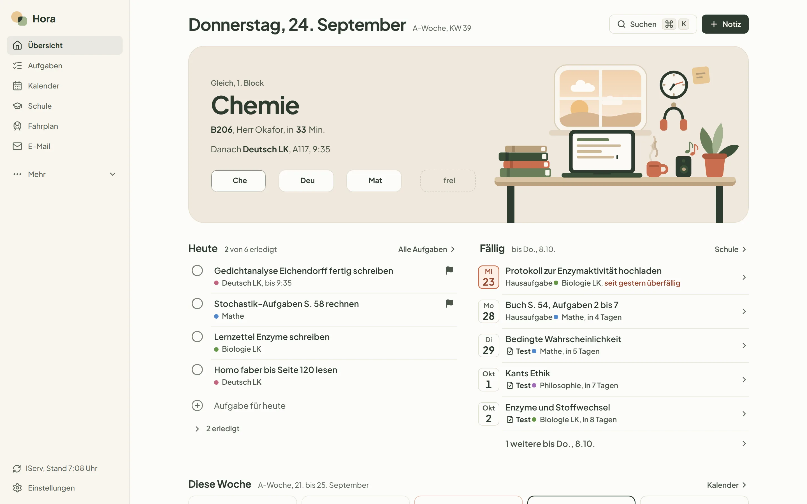
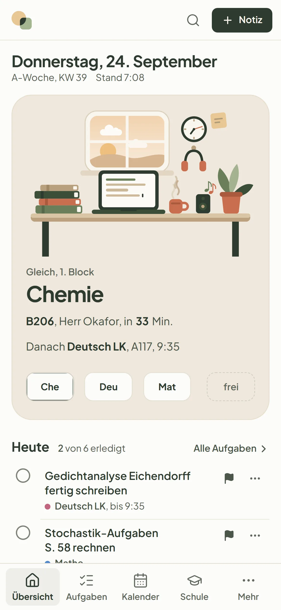

<p align="center">
  
</p>

<p align="center">
  <a href="https://hora-app.netlify.app/download"></a>
  <a href="LICENSE"></a>
  
  
</p>

<p align="center">
  <a href="#download">Download</a> ·
  <a href="#what-is-inside">What is inside</a> ·
  <a href="#how-it-is-built">How it is built</a> ·
  <a href="#getting-started">Getting started</a> ·
  <a href="#license">License</a>
</p>

# Hora

**One app for the school day.** Hora brings timetable, tasks, calendar, mail, transit and a local assistant together, and keeps all of it on your own device. No account, no cloud, no telemetry.

I built Hora because I was tired of switching between separate apps for school, calendar, transit and tasks. Instead of stitching together tools that don't talk to each other, I wanted one system that understands how these things connect: a cancelled class means a changed commute, a new homework assignment becomes a task with a deadline, and a calendar event shows the route to get there.

<p align="center">
  
</p>

<p align="center">
  
  
</p>

The interface is German. The product name lives in one place, see [brand/README.md](brand/README.md). Up to version 0.4 Hora was called Nexus.

## Download

The current version is 0.5.2, a closed beta released on 7 October 2026. Get it from the [download page](https://hora-app.netlify.app/download) or from [GitHub Releases](https://github.com/LeonManuel0705/Hora-Release/releases).

| Platform | What you get |
|:---|:---|
| macOS | Native app. On Apple silicon it brings its own backend and needs no Python. On Intel Macs it needs Python 3 installed and kept; the first start sets up its own Python environment from it and installs its packages once, which takes a few minutes. |
| Windows | Installer for the desktop app, backend included. |
| Linux | AppImage of the desktop app, backend included. |
| Android | Signed app package. |
| iPhone, iPad, browser | Web app, open it from the download page and add it to the home screen. |

On macOS the quickest way is the install script:

```bash
curl -sL https://hora-app.netlify.app/install-macos.sh | bash
```

It checks the checksum of the download, moves Hora into `/Applications` and removes the download quarantine. The app is signed ad hoc and not notarized, so without that step Gatekeeper would block the first launch.

**Coming from Nexus?** Your data comes along. On the first start the desktop apps take over the data of an existing Nexus installation.

**The assistant is a separate download.** No app ships the language model. The first time you open the assistant, Hora asks whether to install it. One click downloads the model (Gemma 4 E2B, about 3 GB) and, on desktops, the llama.cpp runtime for your system (11 to 32 MB), checks both against pinned SHA-256 sums and resumes where it stopped after an interruption. Afterwards the assistant runs entirely on the device. Settings → Assistent removes it again.

## What is inside

| | |
|:---|:---|
| **Overview** | The next lesson with room, teacher and minutes left, today's tasks, everything due, and the week at a glance. |
| **School** | Timetable with A and B weeks, subjects, grades, tests and exams, and the substitution plan straight from IServ. |
| **Tasks** | Tasks by subject and due date, with reminders that carry the study material for a test or the note for a presentation. |
| **Calendar** | Your own events next to Google Calendar, CalDAV and the macOS calendar. |
| **Transit** | Door to door routes in Berlin and Brandenburg with walking legs, VBB fares and the tickets you already own. |
| **Mail** | Read and answer mail from IMAP and SMTP accounts and from Gmail. |
| **Assistant** | A language model that runs on the device and can create tasks and homework for you. Works offline. |
| **Focus** | A Pomodoro timer, notes, bookmarks, spaced repetition and a training tracker. |
| **Backup** | One file carries timetable, subjects, grades, tests, tasks, events and places to another device, without doubling what is already there. |


**And Luna.** The small octopus shows new users around, keeps you company while something loads and sleeps when the day is done.

## How it is built

Hora spans phone, browser and desktop with one interface. The pages are written once, as server rendered HTML with plain CSS and JavaScript, and every platform shows the same ones.

**Backend** (Flask). Serves the interface and about 210 routes, backed by 16 SQLite tables and encrypted JSON files for school data. Handles Google Calendar sync, Gmail, IServ, CalDAV, transit routing and live updates over WebSockets. It only listens on 127.0.0.1.

**Phone app** (Flutter). On a phone the same pages run without the Flask backend. On Android a small server written in Dart answers them from inside the app, backed by the phone's own database, and a WebView shows the result. The web app for iPhone and iPad answers them in the browser the same way.

**Desktop apps**. On macOS the Flutter app runs natively and carries the Flask backend inside its bundle. On Windows and Linux an Electron shell bundles a frozen backend. The local assistant runs in a llama.cpp server that the backend installs on request and starts on 127.0.0.1 with a key of its own. The model leaves memory after five idle minutes and the server stops after thirty.

**Landing page** (Vite). Marketing and download site in English and German, built as a static site for Netlify.

### Decisions

* **Privacy first.** All data stays on the device. Credentials and school data are encrypted at rest using Fernet with PBKDF2 (600k iterations, salts per file). No telemetry, no accounts required.
* **Offline first.** The app works without network access. Background sync picks up when connectivity returns, and the assistant never needs a connection once it is installed.
* **Security hardened.** OAuth CSRF protection, CSP headers with nonces, SSRF validation on CalDAV and mail hosts, CRLF header injection prevention, input sanitization across every endpoint. The desktop apps check the backend with an HMAC handshake before they hand it a token.
* **Transparent migration.** `decrypt_file()` detects plaintext JSON and legacy encryption schemes, and re encrypts in place without user intervention. Data from the Nexus days is found and taken over.
* **One name, one place.** Code never carries the product name. It lives in `brand/brand.json`, and a test fails when it leaks into code.

### Project structure

```
Hora/
  app/                  Flask backend
    app.py              Main application and the classic pages
    ui_pages.py         Pages and API of the interface
    ui_data.py          What the pages show, read from the database
    templates/app/      The pages themselves
    static/app/         Their styles, scripts and Luna
    assistant_service.py  What the assistant understands and may do
    local_ai.py         On-demand install and runtime of the local assistant
    database.py         SQLite/PostgreSQL models (16 tables)
    crypto_utils.py     Fernet encryption with auto-migration
    calendar_service.py CalDAV + macOS EventKit integration
    email_service.py    IMAP/SMTP email client
    iserv_service.py    German school system integration
    vbb_service.py      Transit routing
    transit_service.py  Fares, tickets and walking legs
    google_oauth.py     Google Calendar + Gmail OAuth
  flutter_app/          Flutter app for phone, web and macOS
    lib/
      web_ui/           The Dart server and WebView that show the pages on a phone
      screens/          Classic native screens
      providers/        State management
      services/         Sync, notifications, database, IServ, ...
      tutorial/         Luna's tour
    scripts/            Build scripts for the apps
  desktop/              Electron shell for Windows/Linux
  landing-page/         Vite marketing site
  site/                 Built landing page, published to Netlify
  brand/                Product name (brand.json) and logo locations
  scripts/              Backend freeze, brand and phone UI scripts
  tests/                Backend test suite
```

## Getting started

### Backend and interface

```bash
./setup.sh        # initial setup
./start.sh         # starts on http://127.0.0.1:5050
```

### Phone app

```bash
cd flutter_app
flutter pub get
flutter run
```

After a change to the pages, `python3 scripts/build_mobile_ui.py` copies them into the app. A test fails when the copy has drifted.

### Landing page

```bash
cd landing-page
npm install
npm run dev        # http://localhost:4321
npm run build      # builds into dist/, copy it to ../site/ to publish
```

### Environment variables

Copy `.env.example` to `.env`. For Google Calendar fill in:

```
GOOGLE_CLIENT_ID=<client id>
GOOGLE_CLIENT_SECRET=<client secret>
GOOGLE_PROJECT_ID=<project id>
```

Gmail through the Google sign-in is a restricted scope that Google opens to a published app only after a paid yearly security assessment, so it is off by default and Gmail connects with an app password. Set `GOOGLE_GMAIL=1` to offer it in an installation whose OAuth project may use it. An account that already holds Gmail keeps it either way.

Release builds take a Google OAuth client of the type "Desktop app" from the repository secrets `GOOGLE_OAUTH_CLIENT_ID` and `GOOGLE_OAUTH_CLIENT_SECRET`. `scripts/write_google_client.py` writes it to `app/google_client.json`, which git ignores, and the desktop builds carry it. A local `flutter_app/scripts/build_macos.sh` reads the same two variables from the environment. Without them a build has no Google sign-in.

Leave `SECRET_KEY` unset. Hora then generates a random key in `data/.secret_key` on the first start. Set it only to share one key across machines, and then use a real random value. Setting `DATABASE_URL` switches the backend from SQLite to PostgreSQL.

### Building the apps

```bash
flutter_app/scripts/build_macos.sh     # macOS app with the backend inside

bash scripts/build_backend.sh          # frozen backend, built on the target platform
cd desktop
npm install                            # needs Node 22.12 or newer
npm run build:win                      # per-user installer for Windows
npm run build:linux                    # AppImage and .deb
```

`build_macos.sh` needs Xcode. It first freezes the backend for Apple silicon with `scripts/build_backend_macos.sh`, which downloads a pinned, checksummed CPython and so needs the network; `MACOS_FROZEN_BACKEND=0` skips that for a quick local build. The app starts the frozen backend unless its project folder is a git checkout, and Intel Macs keep starting it with Python.

<details>
<summary>What the desktop build and the first start do in detail</summary>

The build scripts copy the frozen backend into the package and stop if it is missing. `npm start` in `desktop/` runs the shell against the Python source of this checkout (`venv/` in the repo root, or `HUB_DEV_PYTHON`). Unpackaged runs also read `HUB_DEV_PORT`, `HUB_DEV_APP_DATA`, `HUB_DEV_UPDATE_URL` and `HUB_DEV_LEGACY_DOCUMENTS`, so a test run leaves the real port, profile and Documents folder alone. `npm test` checks the shell's URL and version rules and the takeover of old data. With `HUB_TEST_PYTHON` set to a Python that has python-dotenv and cryptography, it also checks the takeover against python-dotenv and the backend's key handling.

On Windows and Linux the first start looks for data from the previous names in `brand/brand.json` under `Documents/<name>`, both where the old app kept it and where Windows or XDG puts the Documents folder. If the new profile holds no user data yet (no data folder, or only what a start created by itself), the app asks before it copies anything. It copies `data/` into the profile and writes the key the old app encrypted with into `data/.secret_key`: a `SECRET_KEY` from the environment, else one from `.env` or `.flaskenv` as Flask found them, else the old `data/.secret_key`. If that key is unclear, cannot be stored exactly, is missing or is one the backend refuses, and data is encrypted with it, it stops with a message instead of guessing and offers to take over everything except the encrypted files. The old folder is only ever read. After "Neu anfangen" the question comes back once the profile's `data` folder is removed while the app is closed. The packaged backend runs with `FLASK_SKIP_DOTENV=1` and `PYTHON_DOTENV_DISABLED=1`, so no `.env` file can change its key or settings.

</details>

## Tech stack

| Layer | Technology |
|:---|:---|
| Interface | Server rendered HTML, plain CSS and JavaScript, Plus Jakarta Sans |
| Backend | Flask, Flask SocketIO, SQLite/PostgreSQL, Fernet |
| Phone | Flutter, Dart, SQLite, Hive, Provider, WorkManager |
| Desktop | Flutter (macOS), Electron and electron builder (Windows, Linux) |
| Assistant | Gemma 4 E2B on llama.cpp, on the device |
| Integrations | Google Calendar API, Gmail API, IServ, CalDAV, VBB |
| Landing page | Vite, DOMPurify |
| CI | GitHub Actions (pytest, flutter analyze, flutter test, builds for every platform, release builds) |

## Deployment

**Landing page** deploys to Netlify as a static site (publish directory: `site/`).

**Backend** runs locally, inside the desktop apps or through `start.sh`.

**Releases** start with a version tag: pushing `v*` runs the release workflow in GitHub Actions, which builds the release packages.

## Tests

```bash
pip install pytest
python -m pytest tests/ -v      # close to 600 backend tests
cd flutter_app && flutter test
cd desktop && npm test
```

## License

Hora is dual licensed.

**[PolyForm Noncommercial 1.0.0](LICENSE)** for everyone who does not earn money
with it. Free to use, study, change and share, for students, teachers, schools
and school authorities alike. Changed versions and every part of the code fall
under the same terms: pass them on free of charge or use them yourself.

**[Commercial license](COMMERCIAL-LICENSE.md)** for anyone who wants to earn
money with Hora or with any part of its code, for example by selling it,
hosting it for others as a paid service or building it into a product.

Copyright (C) 2026 Leon Manuel Töpper. See [NOTICE](NOTICE) for the full
statement, including the license history: Hora was published under the MIT
License until 2026-09-20 and under the AGPL-3.0 up to version 0.5.2. Both offers
have been withdrawn.

Contributions require the [CLA](licensing/CLA.md), which is what keeps the dual
license possible. See [CONTRIBUTING.md](CONTRIBUTING.md).
